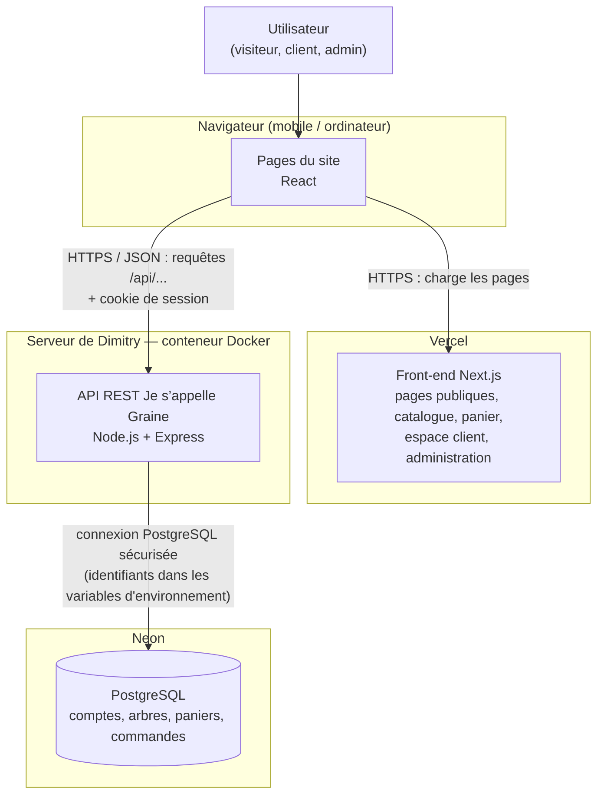
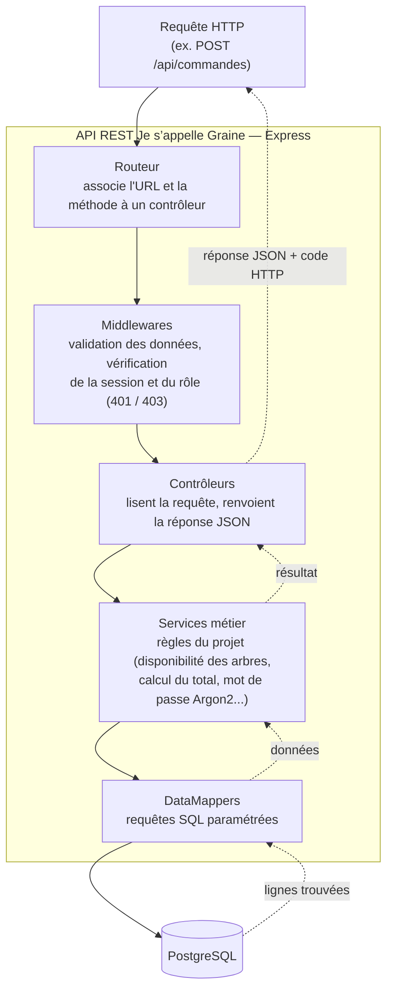
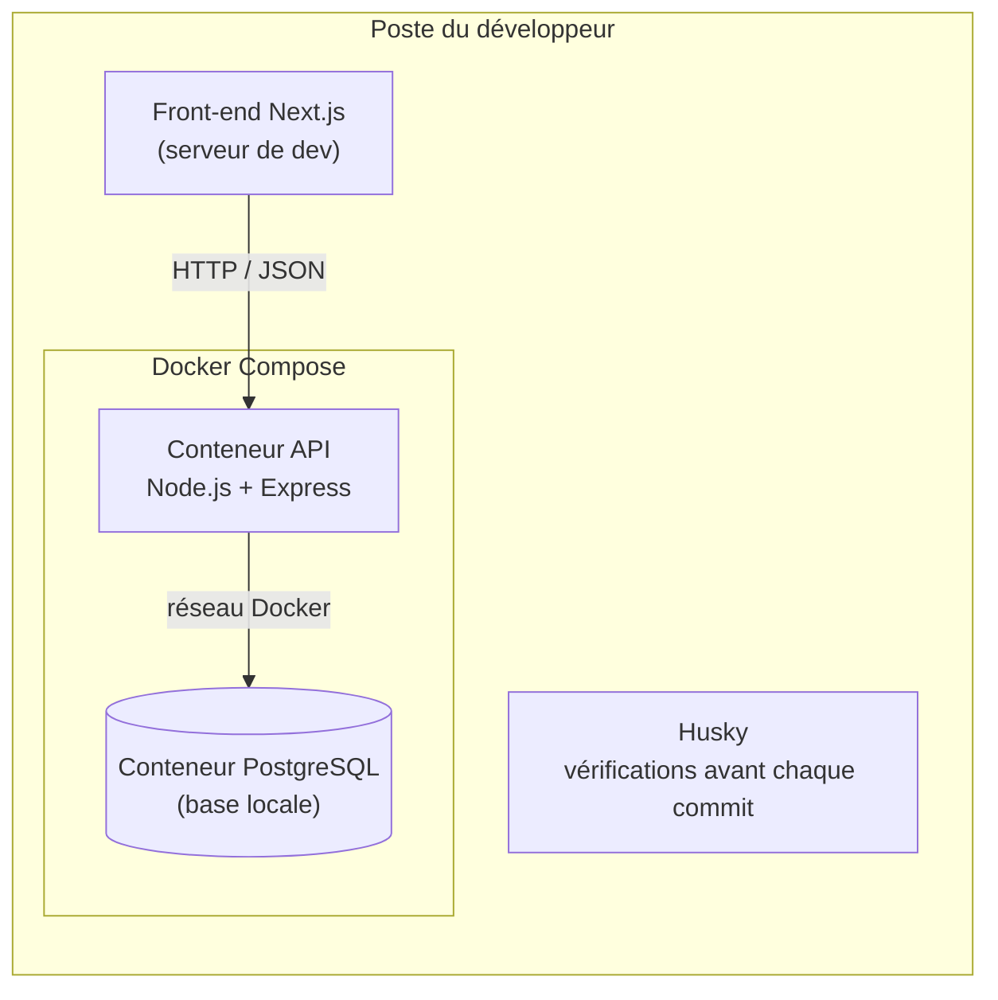

# Architecture de l'application — Je s’appelle Graine

## Lire le diagramme

- Chaque **rectangle** est une brique de l'application ; les **cadres** regroupent ce qui tourne au même endroit (hébergeur).
- Les **flèches** indiquent qui appelle qui, avec le protocole utilisé sur la flèche.
- Le navigateur ne parle **jamais** directement à la base de données : tout passe par l'API.

## 1. Vue d'ensemble (environnement distant)

## 2. Intérieur de l'API REST

Le cahier des charges sépare le back-end en couches : chaque couche a un seul rôle et n'appelle que la couche juste en dessous.

## 3. Environnement de développement

En local, Docker Compose lance l'API **et** une base PostgreSQL, pour que tout le monde travaille avec la même configuration. En distant, seul le conteneur de l'API est déployé, et il se connecte à la base Neon.

## Récapitulatif

| Brique | Technologie | Hébergement (distant) | En développement |
| --- | --- | --- | --- |
| Front-end | Next.js / React | Vercel | Serveur de dev Next.js |
| API REST | Node.js + Express | Serveur de Dimitry (conteneur Docker) | Conteneur Docker (Docker Compose) |
| Base de données | PostgreSQL | Neon | Conteneur Docker (Docker Compose) |
| Accès aux données | DataMapper (ou ORM)| — | — |
| Hooks Git | Husky | — | Poste de chaque développeur |

## Points à valider avec l'équipe

- **DataMapper ou Sequelize** : le DataMapper est privilégié, à confirmer.
- **CORS et cookie** : le front (Vercel) et l'API (serveur de Dimitry) sont sur deux domaines différents ; il faudra autoriser l'origine du front dans l'API et configurer le cookie de session pour qu'il soit bien envoyé.
