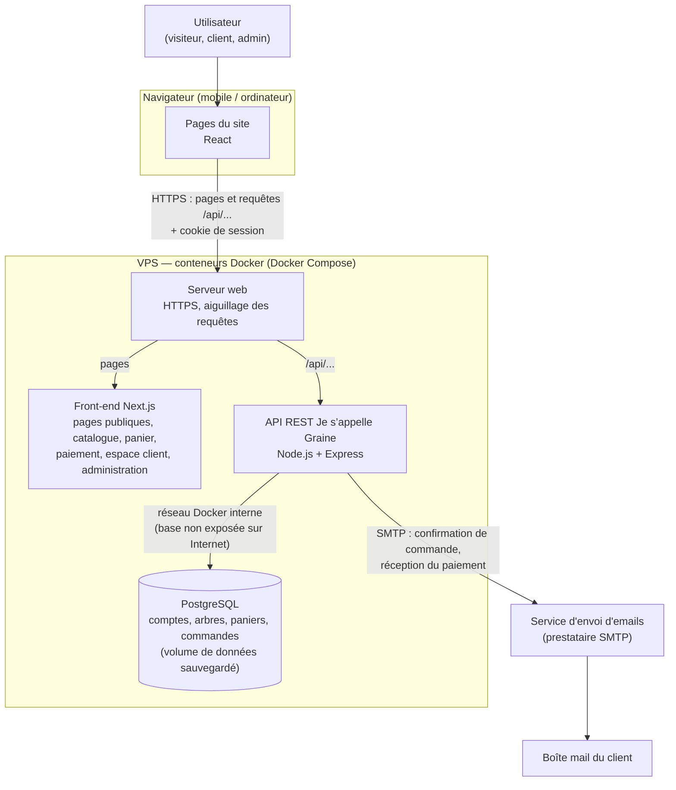
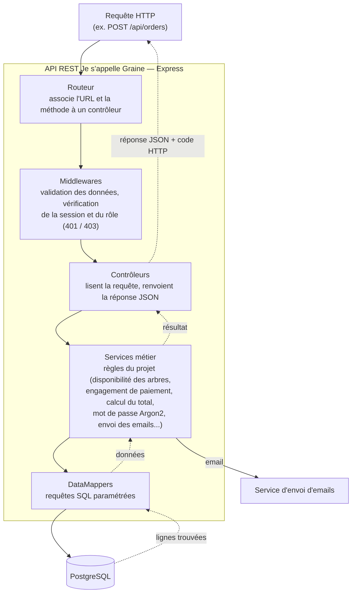
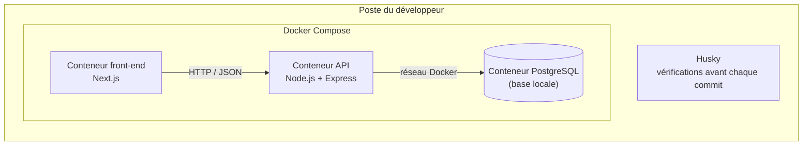

# Architecture de l'application — Je s’appelle Graine

## Lire le diagramme

- Chaque **rectangle** est une brique de l'application ; les **cadres** regroupent ce qui tourne au même endroit.
- Les **flèches** indiquent qui appelle qui, avec le protocole utilisé sur la flèche.
- Le navigateur ne parle **jamais** directement à la base de données : tout passe par l'API.

## 1. Vue d'ensemble (environnement distant : le VPS)

Toute l'application est hébergée sur un **VPS** (serveur privé virtuel loué), chaque brique dans son conteneur Docker. Un serveur web placé devant reçoit toutes les requêtes HTTPS, envoie celles qui commencent par `/api` à l'API et les autres au front-end : le site et l'API partagent ainsi le même nom de domaine.

## 2. Intérieur de l'API REST

Le cahier des charges sépare le back-end en couches : chaque couche a un seul rôle et n'appelle que la couche juste en dessous.

## 3. Environnement de développement

En local, Docker Compose lance les mêmes conteneurs que sur le VPS, pour que tout le monde travaille avec la même configuration.

## Récapitulatif

| Brique | Technologie | Hébergement (distant) | En développement |
| --- | --- | --- | --- |
| Serveur web | À choisir | VPS (conteneur Docker) | — |
| Front-end | Next.js / React | VPS (conteneur Docker) | Conteneur Docker (Docker Compose) |
| API REST | Node.js + Express | VPS (conteneur Docker) | Conteneur Docker (Docker Compose) |
| Base de données | PostgreSQL | VPS (conteneur Docker + volume sauvegardé) | Conteneur Docker (Docker Compose) |
| Envoi d'emails | Prestataire SMTP (Nodemailer côté API) | Service externe | Prestataire de test ou boîte de test |
| Accès aux données | DataMapper (ou ORM) | — | — |
| Hooks Git | Husky | — | Poste de chaque développeur |

## Points à valider avec l'équipe

- **DataMapper ou Sequelize** : le DataMapper est privilégié, à confirmer.
- **Fournisseur du VPS** et **serveur web** (HTTPS, aiguillage `/api`) : à choisir.
- **Sauvegardes de la base** : fréquence et lieu de stockage (hors du VPS).
- **Prestataire d'envoi d'emails** : à choisir.
