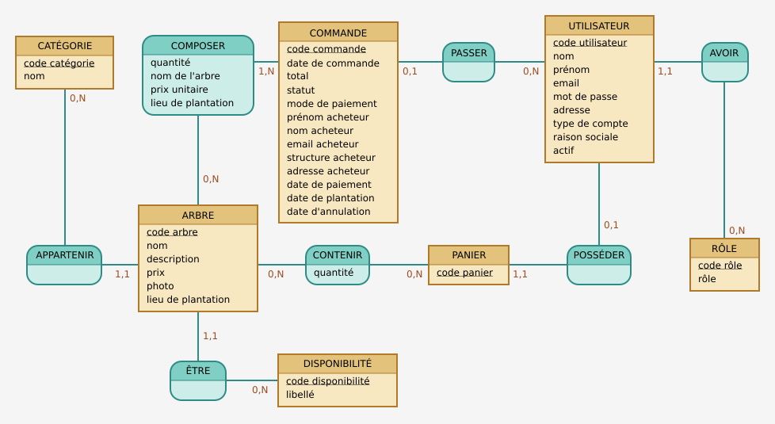

# Modèle conceptuel de données — Je s’appelle Graine

Schéma complet (périmètre MVP) :



## Entités

- Utilisateur
- Rôle
- Arbre
- Catégorie
- Disponibilité
- Panier
- Commande

## Relations et cardinalités

## Source Mocodo

Même MCD au format texte Mocodo (à coller sur [mocodo.net](https://www.mocodo.net/) pour le régénérer ou le comparer) :

```text
CATÉGORIE: code catégorie, nom
COMPOSER, 1N COMMANDE, 0N ARBRE: quantité, prix unitaire
COMMANDE: code commande, date de commande, total, statut, mode de paiement
PASSER, 0N UTILISATEUR, 01 COMMANDE
UTILISATEUR: code utilisateur, nom, prénom, email, mot de passe, adresse, type de compte, raison sociale, actif
AVOIR, 11 UTILISATEUR, 0N RÔLE

APPARTENIR, 0N CATÉGORIE, 11 ARBRE
ARBRE: code arbre, nom, description, prix, photo, lieu de plantation
CONTENIR, 0N PANIER, 0N ARBRE: quantité
PANIER: code panier
POSSÉDER, 01 UTILISATEUR, 11 PANIER
RÔLE: code rôle, rôle

ÊTRE, 11 ARBRE, 0N DISPONIBILITÉ
DISPONIBILITÉ: code disponibilité, libellé
```
