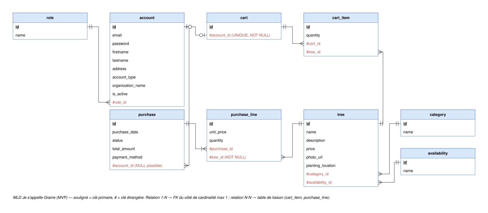

# Modèle logique de données — Je s’appelle Graine

Notation : `__id__` = clé primaire, `#` = clé étrangère.

## Schéma



## Tableau

| Table             | Clé primaire | Colonnes                                                                                                                                                                | Clés étrangères                                                    | Vient de (MCD)                                                   | Règle de passage                                         |
| ----------------- | ------------ | ----------------------------------------------------------------------------------------------------------------------------------------------------------------------- | ------------------------------------------------------------------ | ---------------------------------------------------------------- | -------------------------------------------------------- |
| **role**          | `__id__`     | name                                                                                                                                                                    | —                                                                  | Entité Rôle                                                      | Entité → table                                           |
| **account**       | `__id__`     | email, password, firstname, lastname, address, account_type, organization_name, is_active                                                                               | `#role_id` → role.id                                               | Entité Utilisateur + **Avoir** (1,1 / 0,N)                       | Relation 1-N → FK côté **1,1**                           |
| **category**      | `__id__`     | name                                                                                                                                                                    | —                                                                  | Entité Catégorie                                                 | Entité → table                                           |
| **availability**  | `__id__`     | name                                                                                                                                                                    | —                                                                  | Entité Disponibilité                                             | Entité → table                                           |
| **tree**          | `__id__`     | name, description, price, photo_url, planting_location                                                                                                                  | `#category_id` → category.id, `#availability_id` → availability.id | Entité Arbre + **Appartenir** (1,1 / 0,N) + **Être** (1,1 / 0,N) | Relation 1-N → FK côté **1,1**                           |
| **cart_item**     | `__id__`     | quantity                                                                                                                                                                | `#account_id` → account.id, `#tree_id` → tree.id                   | Relation **Contenir** (0,N / 0,N)                                | Relation N-N → **table de liaison**                      |
| **purchase**      | `__id__`     | purchase_date, status, total_amount, payment_method, buyer_firstname, buyer_lastname, buyer_email, buyer_organization, buyer_address, paid_at, planted_at, cancelled_at | `#account_id` → account.id (peut être NULL)                        | Entité Commande + **Passer** (0,N / 0,1)                         | Relation 1-N → FK côté **0,1**                           |
| **purchase_line** | `__id__`     | tree_name, unit_price, planting_location, quantity                                                                                                                      | `#purchase_id` → purchase.id, `#tree_id` → tree.id (NOT NULL)      | Relation **Composer** (1,N / 0,N)                                | Relation N-N → **table de liaison** (avec ses attributs) |

## Notation texte

```text
role          ( __id__, name )
account       ( __id__, email, password, firstname, lastname, address, account_type, organization_name, is_active, #role_id )
category      ( __id__, name )
availability  ( __id__, name )
tree          ( __id__, name, description, price, photo_url, planting_location, #category_id, #availability_id )
cart_item     ( __id__, quantity, #account_id, #tree_id )
purchase      ( __id__, purchase_date, status, total_amount, payment_method, buyer_firstname, buyer_lastname, buyer_email, buyer_organization, buyer_address, paid_at, planted_at, cancelled_at, #account_id )
purchase_line ( __id__, tree_name, unit_price, planting_location, quantity, #purchase_id, #tree_id )
```

## Règles de passage MCD → MLD

1. **Entité → table.** Le « code xxx » devient la colonne `id`, clé primaire.
2. **Relation 1-N → clé étrangère du côté où la cardinalité maximale est 1** (1,1 ou 0,1), pas de nouvelle table. Ex. _Appartenir_ : un arbre a une seule catégorie, donc une seule colonne `tree.category_id` suffit.
3. **Relation N-N → table de liaison** avec les deux clés étrangères et les attributs portés par la relation (`quantity` pour _Contenir_ ; `tree_name`, `unit_price`, `planting_location`, `quantity` pour _Composer_).

## Notes de traduction

- **Contenir (0,N / 0,N)** : relie directement l'utilisateur et l'arbre. `cart_item.account_id` est obligatoire : pas de panier sans compte. Il n'y a pas de table `cart`, car le panier n'a aucune information propre.
- **Tables de liaison** : on utilise un `id` auto-incrémenté en clé primaire plutôt qu'une clé composite (les deux FK). `cart_item` ajoute `UNIQUE (account_id, tree_id)` : un même arbre n'apparaît qu'une fois dans le panier d'un client, on augmente sa quantité.
- **purchase_line** garde `tree_name`, `unit_price` et `planting_location` : le nom, le prix payé et le lieu de plantation ne changent pas si l'arbre est modifié. `tree_id` est obligatoire et un arbre déjà commandé ne peut pas être supprimé (il passe à l'état « retiré du catalogue »).
- **Être (1,1 / 0,N)** : comme _Appartenir_, la clé étrangère `availability_id` est placée dans `tree`.
- **Passer (0,N / 0,1)** : `purchase.account_id` peut être NULL. Si un compte est supprimé, ses commandes sont conservées sans propriétaire.
- **purchase** fige l'identité de l'acheteur (`buyer_firstname`, `buyer_lastname`, `buyer_email`, `buyer_organization`, `buyer_address`), copiée depuis `account` à la création de la commande : la vente reste identifiable après la suppression du compte. `paid_at`, `planted_at` et `cancelled_at` gardent la date de chaque changement de statut.
- **Statut d'une commande** (`en attente`, `payée`, `plantée`, `annulée`) : changé manuellement par l'admin (`payée` à réception du paiement, `annulée` si le paiement n'est pas arrivé sous 10 jours). Le client peut seulement annuler sa commande quand elle est `en attente`. Aucune commande n'est supprimée. Règles de gestion vérifiées par l'API, pas par le MLD.
- **`account` et `purchase`** : `user` et `order` sont des mots réservés en PostgreSQL, les tables ont été renommées.
