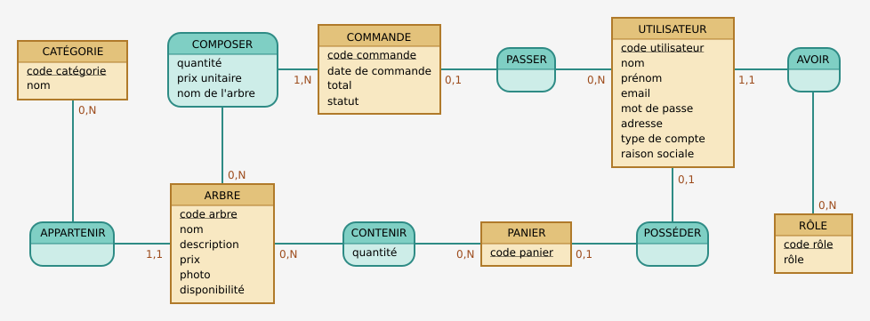

# Modèle conceptuel de données — GreenRoots

Schéma complet (périmètre MVP) :



> Le fichier [05b-MCD.drawio.svg](05b-MCD.drawio.svg) est à la fois une image et un schéma **Draw.io** : l'ouvrir dans VS Code (extension Draw.io) pour le modifier, l'image se met à jour à l'enregistrement.

## Entités

Voir [[01-entites|01-entites]] et [[02-entites-proprietes|02-entites-proprietes]].

- Utilisateur
- Rôle
- Arbre
- Catégorie
- Panier
- Commande

## Relations et cardinalités

Voir [[03-relations|03-relations]] pour la liste des relations et [[04-relations-cardinalites|04-relations-cardinalites]] pour leurs cardinalités.

## Source Mocodo

Même MCD au format texte Mocodo (à coller sur [mocodo.net](https://www.mocodo.net/) pour le régénérer ou le comparer) :

```text
CATÉGORIE: code catégorie, nom
COMPOSER, 1N COMMANDE, 0N ARBRE: quantité, prix unitaire, nom de l'arbre
COMMANDE: code commande, date de commande, total, statut
PASSER, 0N UTILISATEUR, 01 COMMANDE
UTILISATEUR: code utilisateur, nom, prénom, email, mot de passe, adresse, type de compte, raison sociale
AVOIR, 11 UTILISATEUR, 0N RÔLE

APPARTENIR, 0N CATÉGORIE, 11 ARBRE
ARBRE: code arbre, nom, description, prix, photo, disponibilité
CONTENIR, 0N PANIER, 0N ARBRE: quantité
PANIER: code panier
POSSÉDER, 01 UTILISATEUR, 11 PANIER
RÔLE: code rôle, rôle
```
