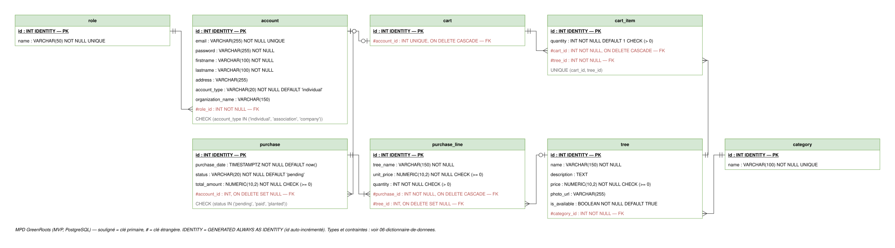

# Modèle physique de données — GreenRoots

Le MPD traduit le [[07-MLD|MLD]] pour un SGBD précis, ici **PostgreSQL** : chaque colonne reçoit un **type**, des **contraintes** et, pour les clés étrangères, un comportement **à la suppression**.
Le détail colonne par colonne est dans le [[06-dictionnaire-de-donnees|dictionnaire de données]].

## Schéma

> Le fichier [08b-MPD.drawio.svg](08b-MPD.drawio.svg) est à la fois une image et un schéma **Draw.io** : l'ouvrir dans VS Code (extension Draw.io) pour le modifier, l'image se met à jour à l'enregistrement.

Notation : souligné = clé primaire, `#` = clé étrangère, `IDENTITY` = `GENERATED ALWAYS AS IDENTITY` (id numéroté automatiquement par PostgreSQL).

## Du MLD au MPD

| Ce que le MPD ajoute | Exemple dans GreenRoots | À quoi ça sert |
| --- | --- | --- |
| **Type** | `price NUMERIC(10,2)`, `purchase_date TIMESTAMPTZ` | Stocker la donnée au bon format (montant exact, date avec fuseau) |
| **NOT NULL** | `email VARCHAR(255) NOT NULL`, `cart.account_id INT NOT NULL` (pas de panier sans compte) | Rendre la colonne obligatoire |
| **UNIQUE** | `email`, `cart.account_id`, `(cart_id, tree_id)` | Interdire les doublons |
| **DEFAULT** | `status DEFAULT 'pending'`, `is_available DEFAULT TRUE` | Valeur mise automatiquement si on n'en donne pas |
| **CHECK** | `quantity > 0`, `status IN ('pending', 'paid', 'planted')` | Refuser les valeurs incohérentes |
| **ON DELETE** | `CASCADE`, `SET NULL` | Dire ce que deviennent les lignes liées quand on supprime la ligne visée |

## Comportements à la suppression

| Clé étrangère | Règle | Quand on supprime... | Résultat |
| --- | --- | --- | --- |
| `cart.account_id` | `ON DELETE CASCADE` | un compte | son panier est supprimé aussi |
| `cart_item.cart_id` | `ON DELETE CASCADE` | un panier | ses lignes de panier sont supprimées |
| `purchase.account_id` | `ON DELETE SET NULL` | un compte | ses commandes sont **conservées**, sans propriétaire |
| `purchase_line.purchase_id` | `ON DELETE CASCADE` | une commande | ses lignes de commande sont supprimées |
| `purchase_line.tree_id` | `ON DELETE SET NULL` | un arbre | les lignes de commande restent (nom et prix déjà copiés) |
| `account.role_id`, `tree.category_id`, `cart_item.tree_id` | aucune (par défaut) | un rôle, une catégorie, un arbre encore utilisé | PostgreSQL **refuse** la suppression |

## Règle de gestion non couverte par le MPD

Le client **n'a pas le droit** de supprimer une commande `paid` ou `planted` : seules les commandes `pending` peuvent l'être. Le statut est changé **manuellement par l'admin**.

Une contrainte `ON DELETE` ne regarde pas la valeur du statut : cette règle est donc vérifiée par l'**API**, avant le `DELETE` (cf. [[04-relations-cardinalites|04-relations-cardinalites]], décisions).
